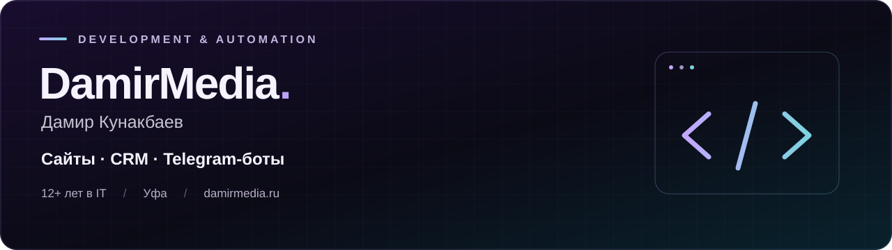

  <a href="https://damirmedia.ru/"><b>Сайт</b></a> &nbsp; · &nbsp;
  <a href="https://damirmedia.ru/portfolio"><b>Портфолио</b></a> &nbsp; · &nbsp;
  <a href="https://t.me/damirmedia"><b>Обсудить проект в Telegram ↗</b></a>

### Привет, я Дамир

Frontend-разработчик и системный администратор из Уфы. **Более 12 лет в IT.** Создаю сайты, внутренние сервисы и Telegram-ботов — от идеи и интерфейса до запуска и поддержки.

Соединяю frontend, API и инфраструктуру, чтобы сокращать ручные операции и делать рабочие процессы прозрачнее. Сейчас развиваю CRM и Telegram-интеграции для сервисного центра, сопровождаю коммерческие веб-проекты и корпоративные IT-сервисы.

### Что разрабатываю

- **Сайты и веб-приложения** — адаптивные интерфейсы на Next.js, React и TypeScript.
- **CRM и внутренние сервисы** — учёт, статусы, кабинеты менеджеров и автоматизация процессов.
- **Telegram-боты и интеграции** — работа с API, файлами и бизнес-сценариями.
- **Инфраструктура** — серверы, деплой, поддержка и стабильная работа проектов.

### Технологии

**Основной стек** &nbsp; `Next.js` `React` `TypeScript` `JavaScript` `HTML / CSS`

**Интеграции и CMS** &nbsp; `REST API` `Telegram Bots` `WordPress` `1С-Битрикс`

**Инструменты и инфраструктура** &nbsp; `Git` `Linux` `Nginx / Apache`

### Избранные кейсы

| Проект | Что сделано |
| --- | --- |
| [Чача-Пури-Хачапури](https://chacha-puri-khachapuri.ru/) | Перенос сайта ресторана с WordPress на Next.js: меню, акции, доставка, галерея и бронирование. |
| [Гидромаг](https://new.zipvoda.ru/) | Сайт сервисного центра с онлайн-проверкой статуса ремонта. |
| [CRM «Гидромаг»](https://damirmedia.ru/portfolio) | Внутренняя CRM на Next.js вместо 1С: приём техники, этапы ремонта и история обращений. |
| [Интерфейсы на Bitrix](https://damirmedia.ru/portfolio) | Чат поддержки, согласование возвратов и мобильный кабинет менеджера. |

### Открытый код

| Репозиторий | О проекте |
| --- | --- |
| [CinemaVision](https://github.com/zver1k/cinema) | Каталог фильмов и сериалов: поиск, авторизация, профиль, избранное и списки просмотра. `Next.js` `PostgreSQL` |
| [gidromag-bot](https://github.com/zver1k/gidromag-bot) | Загрузка фото и документов на Яндекс.Диск, организация по накладным, статистика и разграничение доступа. `Python` |
| [media-telegram-bot](https://github.com/zver1k/media-telegram-bot) | Telegram-бот для скачивания видео с выбором качества и inline-управлением. `Node.js` `Telegraf` |
| [habbits](https://github.com/zver1k/habbits) | Трекер привычек с прогрессом, комментариями по дням и автодеплоем через GitHub Actions. `JavaScript` |
| [currency-exchange](https://github.com/zver1k/currency-exchange) | Конвертер валют с валидацией и Frankfurter API. `React` |
| [weather-wiget](https://github.com/zver1k/weather-wiget) | Адаптивный виджет погоды с геолокацией и поиском по городу. `React` |

---

**Есть задача для сайта, сервиса или бота?** [Напишите в Telegram →](https://t.me/damirmedia)

[damirmedia.ru](https://damirmedia.ru/) · Уфа · Удалённо и гибридно
